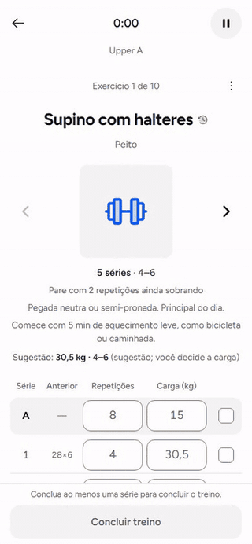
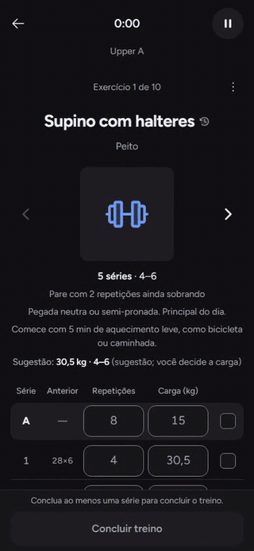
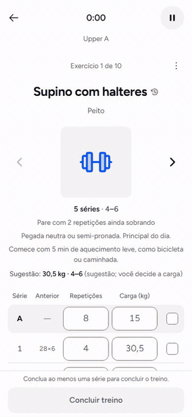
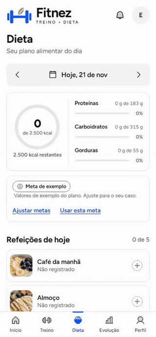
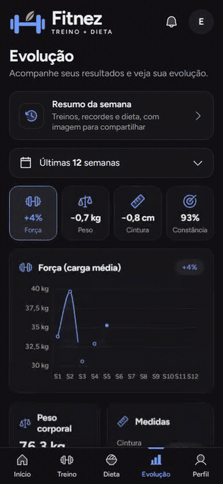

# Fitnez

Treino e dieta num só app, que monta o seu plano, registra cada série em segundos e funciona sem internet, com os dados guardados só no seu celular.



**Abrir o app:** <https://caua-manuel.github.io/fitnez/>. Para conhecer sem preencher nada, toque em **Ver com dados de exemplo**.

## O problema

Quem treina em academia anota carga e repetição no papel, numa planilha ou num app que pede conta, mostra anúncio e manda os dados para um servidor. No meio da série ninguém quer digitar muito. E um plano copiado da internet não sabe se você treina jiu-jitsu na quarta, se nunca pegou numa barra ou se está grávida.

O Fitnez resolve isso para mim e para dois ou três amigos: um plano de 12 semanas montado a partir de nove perguntas, registro rápido na academia, dieta do dia e evolução, tudo offline e sem conta.

## Funcionalidades

- **Assistente de início:** nove perguntas e o app monta treinos, rotina da semana e metas de dieta. Gestação, menores de 14 anos e condições de saúde têm regras próprias e conservadoras.
- **Registro de série em um toque:** a carga e as repetições sugeridas aparecem em cinza; tocar na caixa registra assim mesmo.
- **Progressão automática:** dupla progressão (sobe a carga quando todas as séries chegam ao topo da faixa) e uma semana leve a cada 4.
- **Na academia:** a tela fica acesa, o celular vibra no fim do descanso, o cronômetro continua certo se você sair do app, há calculadora de anilhas dentro da série e as últimas 5 sessões de cada exercício.
- **Recordes e aviso de estagnação:** quando um exercício para de evoluir, o app sugere uma ação concreta.
- **Dieta do dia:** refeições com opções, calorias, macros e água, com metas editáveis.
- **Evolução:** peso, medidas, constância e um resumo da semana que vira imagem para mandar no WhatsApp.
- **Compartilhar plano com amigos:** exporta só o plano (sem dados pessoais) e o amigo revisa antes de aplicar.
- **Seus dados protegidos:** backup em JSON com lembrete a cada 7 dias de uso, armazenamento persistente e exportação em CSV.
- **Modo demonstração:** 4 semanas de dados fictícios, isolados dos dados reais.

| Descanso | Recorde | Dieta do dia | Resumo da semana |
| --- | --- | --- | --- |
|  |  |  |  |

## Decisões técnicas

1. **Dados só no aparelho.** Sem servidor, sem conta e sem custo: IndexedDB no navegador e backup em arquivo. O preço é que a perda de dados vira um problema do app, e por isso existem o lembrete de backup por dias de uso, o pedido de armazenamento persistente e a restauração transacional. ([ADR 002](docs/decisoes/002-armazenamento-local-migracao-backup.md))
2. **Regras em funções puras, com teste.** Progressão, deload, metas de dieta, estagnação e o assistente ficam em `src/domain/`, sem relógio, sem DOM e sem banco: a data entra como parâmetro. Assim a regra mais importante do app roda centenas de vezes por segundo nos testes, sem navegador.
3. **Migração e restauração transacionais.** Importar um backup ou aplicar o plano de um amigo é uma única transação com revisão: ou entra tudo, ou nada muda, e o estado anterior fica guardado para desfazer.
4. **Fila de gravações.** Cada toque atualiza a tela na hora e entra numa fila única de gravação. Se outra aba gravar antes, as mudanças pendentes são reaplicadas sobre o estado novo, em vez de uma sobrescrever a outra.
5. **PWA offline com orçamento de peso.** Service worker gerado no build, carga inicial e total medidas a cada build e telas raras carregadas sob demanda. O build falha se o peso passar do limite. ([ADR 011](docs/decisoes/011-pronto-para-amigos-e-ferramentas-da-academia.md))

## Stack

React 19, TypeScript e Vite, com CSS próprio e a fonte Figtree servida com o app. Ícones Phosphor e a biblioteca motion para animações; nenhuma outra dependência de produção. Testes com Vitest (unidade e integração com `fake-indexeddb`) e Playwright (ponta a ponta em viewport de celular). CI e publicação no GitHub Pages por GitHub Actions.

**Números:** Lighthouse no celular com 100 em acessibilidade, boas práticas e SEO; LCP de 1,7 s em 4G lento com CPU 4× mais lenta; CLS 0. Carga inicial de 187 KB de JavaScript (gzip). 782 testes de unidade e integração e cerca de 200 de ponta a ponta.

## Como rodar

Requer Node 24 ou superior.

```
npm ci
npm run dev          # desenvolvimento
npm run check        # tipos, testes, build e orçamento de peso
npm run test:e2e     # Playwright
```

No PowerShell do Windows, use `npm.cmd`. Mais detalhes em [INICIO.md](INICIO.md).

## Como foi feito

Eu construí o Fitnez orquestrando agentes de IA especialistas, cada um com uma pasta e uma responsabilidade:

| Agente | Papel |
| --- | --- |
| `arquiteto` | Decide estrutura e camadas; escreve os ADRs |
| `frontend` | Telas, componentes, PWA e design system |
| `backend-dados` | IndexedDB, migração, backup, regras de domínio |
| `conteudo-treino-nutricao` | Dono das regras e números de treino e dieta |
| `ux-acessibilidade` | Fluxos, textos, uso com uma mão, WCAG AA |
| `qa-testes` | Testes de unidade, integração e ponta a ponta |
| `seguranca-privacidade` | Dados de saúde, CSP, revisão antes de publicar |
| `devops-github` | Build, CI, orçamento de peso e GitHub Pages |

O meu papel foi decidir o que construir, dividir o trabalho, revisar cada entrega e integrar. Toda decisão técnica virou um ADR em [docs/decisoes/](docs/decisoes/) e toda entrega deixou um handoff curto em [docs/handoffs/](docs/handoffs/), com o que mudou e como foi verificado. Regra fixa: nenhum número de treino ou dieta muda sem passar pelo agente de conteúdo, com o motivo registrado.

**O que deu certo.** Os agentes trabalharam em paralelo sem se atropelar porque cada um tinha uma pasta. ADRs e handoffs deram memória ao projeto: um agente novo lia a decisão em vez de redescobri-la. As revisões cruzadas acharam problemas reais: a segurança encontrou dois caminhos pelos quais o modo demonstração poderia apagar os dados reais antes de ele ir ao ar, e a revisão de conteúdo de 10 perfis fictícios mostrou que uma pessoa grávida recebia o mesmo treino com barra de qualquer iniciante.

**O que deu errado.** A escala "como terminou" do jiu-jitsu foi escrita ao contrário: a tela dizia que 5 era "ótimo" e a regra que libera a terceira aula semanal tratava 5 como "destruído". Todos os testes passavam, porque a tela tinha os testes dela e a regra tinha os dela, e nenhum conferia que os dois falavam a mesma língua. O erro só apareceu lendo o app como usuário. A correção foi criar uma fonte única para a escala (`FEEL_SCALE`) e um teste que falha se a tela voltar a escrever a escala à mão. A lição: testar o contrato entre as partes, não só cada parte. Agentes especialistas otimizam a própria pasta, e as costuras entre elas precisam de um dono.

Outros tropeços: limites de uso interrompendo agentes no meio da tarefa (o trabalho fica salvo e eles retomam, mas o plano precisa ser tolerante a isso) e documentação que envelhece mais rápido que o código. O estudo de caso completo está em [docs/ESTUDO-DE-CASO.md](docs/ESTUDO-DE-CASO.md).

## Aviso de saúde

O Fitnez não substitui médico, nutricionista ou profissional de educação física. As metas são estimativas. Pare qualquer exercício que cause dor.

## Privacidade

Treinos, medidas e anotações ficam só no aparelho. Não há conta, analytics nem envio de dados. O plano compartilhado leva só o plano; o cartão da semana não leva peso nem medidas, a não ser que você marque.

## Licença

MIT. As skills de terceiros em `agents/` e `.claude/skills/` mantêm as licenças de origem.
